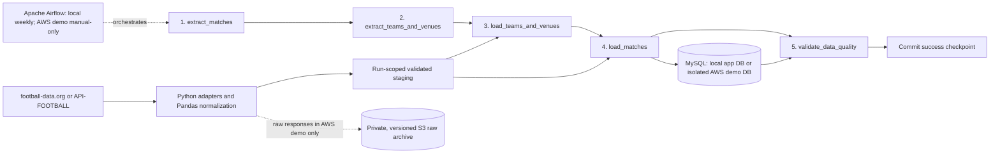

# Premier League Data Pipeline

An end-to-end Python ETL pipeline that collects Premier League fixtures from football-data.org or API-FOOTBALL, validates and loads season-aware data into MySQL, and orchestrates runs with Apache Airflow.

[](https://github.com/Mohamed254-pixel/premier-league-data-pipeline/actions/workflows/tests.yml)

## Project highlights

- **760 fixtures recorded across two seasons** in the verified local database snapshot: 380 archived 2024–25 fixtures and 380 season-2026 fixtures.
- **Five-stage Airflow DAG** for extraction, team and venue loading, fixture loading, and data-quality validation.
- **Weekly incremental workflow** configured for Monday 06:00 UTC; a scheduler-created run passed all five tasks in the November 7, 2026 activation record.
- **Idempotent, season-aware MySQL UPSERTs**, provider-specific ID mappings, and success checkpoints committed after validation.
- **327 automated tests passed** in the verified suite; the latest `main` GitHub Actions run passed all five jobs.
- **Real, time-boxed AWS demo** on EC2 with Docker/Airflow, private MySQL, and S3 raw archives. The first cloud run loaded 380 current-season fixtures; a supervised repeat reprocessed 30 with no duplicate fixtures or business-value changes. EC2 was stopped after the demo.

> These counts are dated verification snapshots, not a live database query. Local service availability and later scheduled runs have not been verified. The AWS deployment was a demonstration, not an always-on service.

## Architecture



The local deployment and AWS demonstration were isolated environments. The AWS demonstration ran on EC2 with Docker and an isolated MySQL database; raw provider responses were archived to S3. Its copied DAG was manual-only and paused after supervised runs. For the detailed component and data-model design, see [architecture](docs/architecture.md) and [data model](docs/data-model.md).

## Screenshots and execution evidence

No authentic Airflow, database-client, or AWS console screenshots were retained in the repository. Rather than substitute mock UI images, the project links to sanitized execution records and live GitHub Actions status:

| Evidence | Verified result | Record |
| --- | --- | --- |
| Airflow DAG | Five tasks passed in the November 7 local scheduler-created run; the November 11 AWS manual run and repeat also passed all five tasks. | [Local scheduling record](docs/phase2-scheduling-results.md) · [AWS run and repeat evidence](docs/portfolio/phase3/README.md) |
| MySQL | 380 archived 2024 fixtures plus 380 season-2026 fixtures in the local snapshot; AWS repeat confirmed 760 total with historical rows preserved. | [Bootstrap counts](docs/phase2-bootstrap-results.md) · [AWS database verification](docs/portfolio/phase3/README.md) |
| GitHub Actions | Latest recorded run on `main` (`29bbe46`, November 11, 2026) succeeded across infrastructure lint, Airflow import, pytest, MySQL 8.0, and MySQL 8.4 jobs. | [Workflow run](https://github.com/Mohamed254-pixel/premier-league-data-pipeline/actions/runs/42969764703) · [Workflow history](https://github.com/Mohamed254-pixel/premier-league-data-pipeline/actions/workflows/tests.yml) |
| AWS deployment | CloudFormation created the reviewed demo stack; EC2-hosted Airflow ingested 380 season-2026 fixtures and archived raw responses to S3. One 30-fixture repeat made no duplicate or business-value changes. | [Sanitized Phase 3 evidence](docs/portfolio/phase3/README.md) |

The [visual evidence index](docs/portfolio/screenshots/README.md) documents which screenshots are unavailable and why. It does not claim that a screenshot was captured when only text records exist.

## Technology stack

Python 3.11+, Pandas, Requests, MySQL 8+, Apache Airflow 3.3.1, Docker Compose, pytest, GitHub Actions, AWS CloudFormation, Amazon EC2, Amazon S3, AWS Systems Manager, IAM, and AWS Secrets Manager.

## Pipeline workflow

1. **Extract fixtures** from the selected provider and write a validated, run-scoped batch.
2. **Extract teams and venues** and verify fixture membership for the requested season.
3. **Load teams and venues** while preserving canonical records and storing season snapshots.
4. **Load fixtures** with season-aware UPSERTs and provider-ID mappings.
5. **Validate data quality**, compare the protected historical archive, then commit the success checkpoint.

Retries reuse the frozen batch for a run ID. Incremental windows overlap prior dates, recheck unresolved fixtures by ID, and periodically reconcile the active season. The 2024 archive is protected from refresh. See [incremental design and recovery](docs/architecture.md) and the [provider configuration](docs/football-data-source.md).

## Data quality and reliability

- Preserves the committed 2024–25 CSV archive and validates loaded historical values against it.
- Uses season-scoped team memberships and separate source-ID registries to prevent cross-provider ID collisions.
- Enforces primary/unique keys and foreign keys; rejects duplicate or colliding fixture identities.
- Allows missing scores for scheduled/postponed fixtures and requires scores for completed fixtures.
- Advances per-season checkpoints only after final validation; failed runs do not publish a success checkpoint.
- Uses run ownership, transaction boundaries, bounded API retries, Airflow task timeouts, and repeat-run checks.

See the [MySQL schema](sql/schema.sql), [analytics queries](sql/analytics.sql), and [detailed data model](docs/data-model.md).

## AWS deployment demonstration

The November 11, 2026 demonstration used a dedicated CloudFormation stack in `us-east-2`: a time-boxed EC2 host running Docker and Airflow, isolated MySQL and PostgreSQL containers, a private versioned S3 bucket for raw responses, scoped IAM, Secrets Manager, and Systems Manager access. It had zero inbound EC2 rules; the Airflow UI was accessed through Systems Manager and loopback. The DAG was manual-only, paused after the run, and had no recurring cloud schedule.

The first successful AWS run inserted 380 season-2026 fixtures while preserving the 380-fixture historical archive. A supervised incremental repeat reprocessed 30 fixtures: zero new fixtures, duplicates, mapping collisions, rejected rows, or business-value changes. Both runs archived and verified raw S3 objects. The EC2 instance was stopped after the demonstration. This was not a continuously available production service; consult the dated [AWS evidence and cost record](docs/portfolio/phase3/README.md) for capacity, cost assumptions, shutdown, and the state observed at evidence capture.

## Testing and verification

The latest recorded local suite result is **327 passed, zero failures, zero errors, zero skips**. The successful `main` Actions run executes five jobs: CloudFormation lint, Airflow DAG import, pytest, MySQL 8.0 integration, and MySQL 8.4 integration. CI uses disposable database credentials and no provider API token.

Run the local suite with:

```bash
python3 -m venv .venv
source .venv/bin/activate
python -m pip install -r requirements-dev.txt
python -m pytest
```

Real MySQL integration tests require an explicitly configured disposable test server; see [test and setup guidance](docs/phase2-verification.md). Do not point test settings at a production database.

## Local setup

Use Python 3.11+, MySQL 8.0.16+, and Docker Desktop for Airflow. The tests and standalone scripts do not need Docker.

```bash
git clone https://github.com/Mohamed254-pixel/premier-league-data-pipeline.git
cd premier-league-data-pipeline
python3 -m venv .venv
source .venv/bin/activate
python -m pip install -r requirements-dev.txt
cp -n .env.example .env
```

Configure provider and MySQL credentials in the private `.env`; never commit secrets.

For a new database, review [schema migrations and rollback guards](docs/phase2-migrations.md) and the [provider setup guide](docs/football-data-source.md) before applying schema changes. Follow the [local service startup guide](docs/phase2-service-startup.md) and [AWS demo runbook](deploy/aws/demo/README.md) for deployment and recovery details.

## Limitations and future improvements

- This is a weekly fixture refresh, not a real-time score service. Corrections outside the overlap window may wait for full reconciliation.
- Current local service health and later weekly runs are not asserted by the dated evidence in this repository.
- The AWS deployment was a low-cost, time-boxed demonstration. EC2 was stopped after the run; do not infer that the stack is currently operating or that all retained AWS resources have been deleted.
- Provider access, quotas, and season coverage depend on the configured account and subscription.
- Future work could add automated alerting, scheduled backup-retention checks, and a fresh cloud demonstration when needed.

## Further documentation

- [Architecture and incremental ETL details](docs/architecture.md)
- [MySQL data model](docs/data-model.md)
- [Phase 2 bootstrap, repeat, and scheduling evidence](docs/phase2-bootstrap-results.md) · [repeat](docs/phase2-repeat-results.md) · [scheduler](docs/phase2-scheduling-results.md)
- [AWS Phase 3 deployment plan](docs/phase3-aws-deployment-plan.md) · [sanitized portfolio evidence](docs/portfolio/phase3/README.md)
- [AWS demo deployment, cost, and cleanup runbook](deploy/aws/demo/README.md)

Licensed under [MIT](LICENSE).
